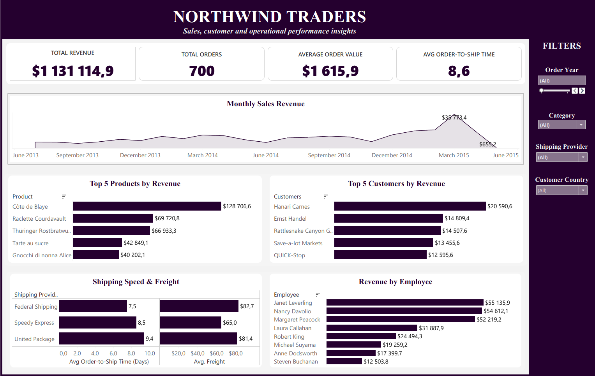

# Northwind Traders — Business Performance Analysis

A business analytics capstone exploring sales performance, product and customer contribution, and shipping outcomes using PostgreSQL, SQL, and Tableau Public.

## Dashboard preview

## Business context

Northwind Traders is a specialty-foods business. Management needs a clearer view of business performance and areas that may warrant further investigation.

## Business problem

How can the available customer, order, product, and shipping data help management understand sales performance and identify operational questions worth investigating?

## Objectives

- Build and understand a relational data model from the supplied workbook.
- Use SQL to calculate and investigate business measures.
- Communicate findings through a Tableau dashboard and a concise business narrative.
- Translate the analysis into practical, evidence-based next steps.

## Dataset overview

The source workbook contains seven related tables:

| Table | Records |
|---|---:|
| Customers | 91 |
| Orders | 700 |
| Order Details | 1,801 |
| Products | 77 |
| Categories | 8 |
| Employees | 9 |
| Shippers | 3 |

The supplied workbook was used as the source for analysis. The dataset itself is **not included** in this repository. 

## Tools

- **PostgreSQL / pgAdmin** — relational data modelling and SQL analysis
- **SQL** — business metrics and investigation queries
- **Tableau Public** — dashboard development and visual communication
- **Excel** — source workbook review and data inspection

## Key business questions

1. What does the available data show about overall sales performance?
2. Which products and customers contribute most to recorded revenue?
3. How do shipping providers compare on average freight cost and order-to-ship time?
4. How many orders were shipped after their required dates, and what should be investigated next?

## Headline results

The current analysis reports the following measures:

- **Estimated revenue:** $1 131 114.86
- **Orders:** 700
- **Average order value:** $1 615.88
- **Average order-to-ship time:** 8.6 days

## Findings and implications

### 1. Reporting-period completeness matters

The latest order date in the analysis is May 4, 2015, making May a partial reporting period. March recorded the highest monthly revenue in the analysed period, with 64 orders. Avoid comparing the incomplete May period directly with complete months.

### 2. Revenue contribution is uneven

Recorded revenue varies across products and customers. Côte de Blaye is the highest-revenue product in the current analysis. Revenue contribution can help prioritize further commercial review, but it does not by itself establish profit, customer loyalty, or long-term value.

### 3. Shipping involves cost and time trade-offs

Federal Shipping has the shortest average order-to-ship time in the current analysis (7.51 days). Speedy Express has the lowest average freight value (64.95), while United Package has the longest average order-to-ship time (9.40 days). No single measure is sufficient to declare a provider the best choice. The freight currency/unit should be confirmed against the source data.

### 4. Some orders were shipped after their required dates

A total of 32 orders were shipped after their required dates; 668 of 700 (95.4%) were shipped on or before the required date. This measures shipment timing against the required date, **not confirmed on-time delivery to the customer**. The late orders should be investigated for recurring patterns and reasons.

## Recommendations

1. Investigate the 32 late shipments for recurring patterns by period, product, and shipping provider; capture delay reasons where possible.
2. Compare shipping providers using freight cost and order-to-ship time alongside service requirements and shipment characteristics.
3. Use complete reporting periods and consistent metric definitions before making sales or inventory decisions.
4. Add product cost/margin data and customer purchase history before making stronger profitability or retention claims.

## Data model

The relational structure connects:
- Orders to Customers, Employees, Shippers, and Order Details
- Order Details to Products
- Products to Categories

## Limitations

- May 2015 is an incomplete reporting period in the available orders.
- Actual delivery dates and reasons for delays are not available in the current analysis.
- Product costs and margins are not available, so revenue must not be treated as profit.

## Author

**Diana Chirwa**  
Capstone Project | Zion Tech Hub

---

This project is for portfolio and learning purposes. 
